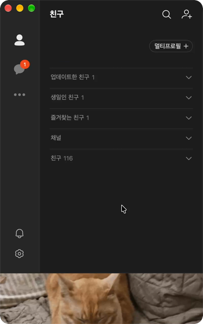
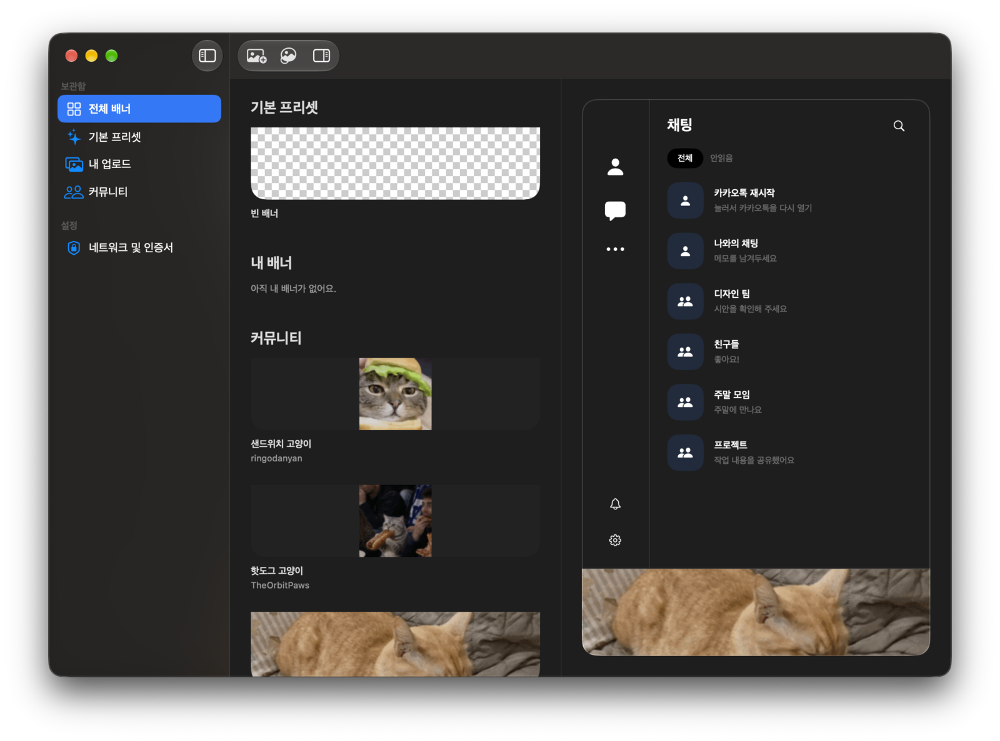
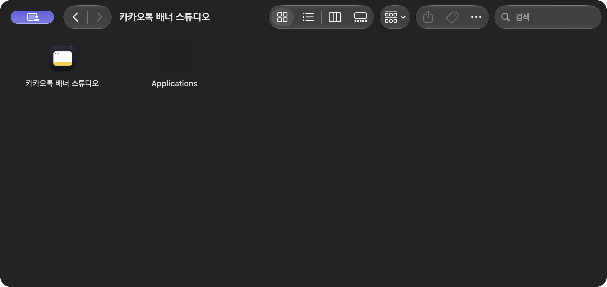
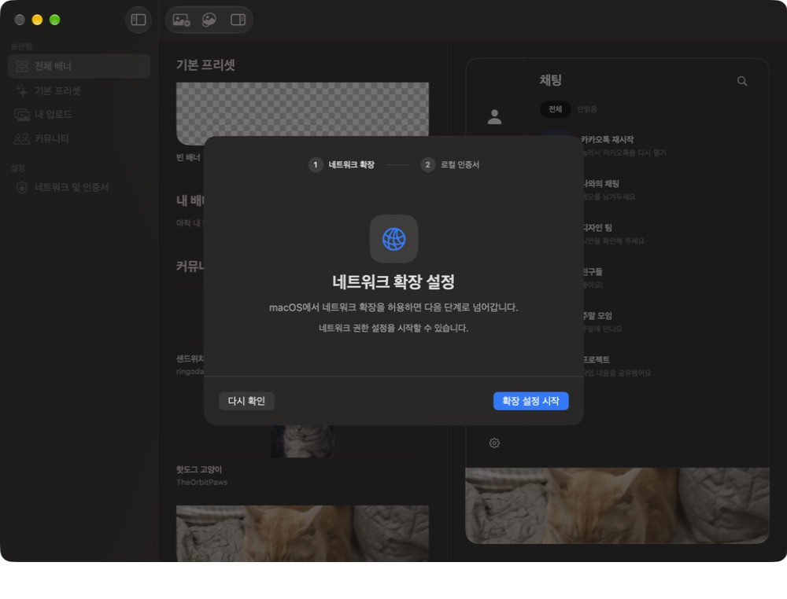
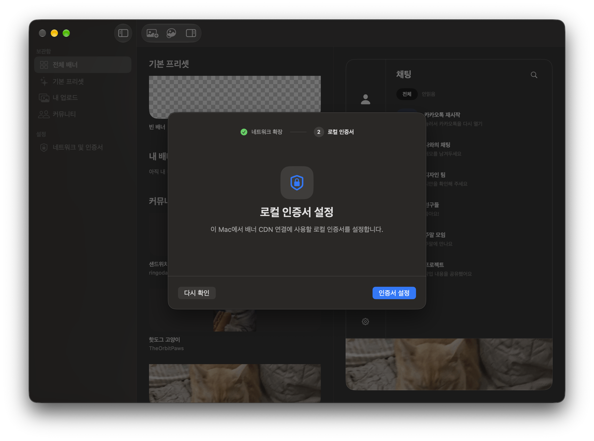

# 카카오톡 배너 스튜디오

Mac용 카카오톡 채팅 목록 하단에 원하는 배너를 표시하는 비공식 앱입니다. 광고를 비우거나, 카카오톡 배경에 맞추거나, 내 이미지나 커뮤니티 배너로 바꿀 수 있습니다.

## 카카오톡 적용 화면

  

## 스튜디오 미리보기

## Requirements

아래 환경에서 배너 적용을 테스트했습니다. 다른 환경은 호환 여부를 확인하지 않았습니다.

| 항목 | 테스트 환경 |
| --- | --- |
| Mac | Apple Silicon (arm64) |
| 운영체제 | macOS 27.2 (빌드 26B123) |
| 카카오톡 | Mac용 26.9.0 (빌드 2006) |

## Mac에서 바로 설치하기

1. [GitHub Releases](https://github.com/GwonHyeok/kakao-banner-studio/releases/latest)의 **Assets**에서 `.dmg` 파일을 다운로드하고 엽니다.
2. 아래 창에서 **카카오톡 배너 스튜디오**를 **Applications**로 드래그합니다.

   

3. Finder의 **응용 프로그램**에서 **카카오톡 배너 스튜디오**를 엽니다.
### 첫 실행 설정

1. **네트워크 확장 설정** 화면에서 **확장 설정 시작**을 누릅니다.

   

2. macOS가 승인을 요청하면 **시스템 설정**을 열고 **카카오톡 배너 스튜디오**의 네트워크 확장을 허용합니다. 앱으로 돌아와 화면이 그대로라면 **다시 확인**을 누릅니다.
3. **로컬 인증서 설정** 화면에서 **인증서 설정**을 누릅니다. macOS 확인 창이 표시되면 확인을 완료합니다.

   

4. **설정 완료** 화면에서 **완료**를 누르면 배너를 선택할 수 있습니다.

## 배너 바꾸기

1. **기본 프리셋**에서 **빈 배너** 또는 **카카오톡 일체형**을 선택합니다. **커뮤니티**에서 공유 배너를 고르거나, 상단의 **이미지 추가**로 PNG, JPEG, GIF를 불러올 수도 있습니다.
2. 오른쪽 미리보기에서 배너를 확인합니다.
3. 미리보기의 **카카오톡 재시작**을 누릅니다. 카카오톡이 다시 열리면 하단 배너에 적용됩니다.

**빈 배너**는 하단 공간을 연회색으로 비워 둡니다. **카카오톡 일체형**은 라이트 모드의 사이드바와 본문 색을 배너까지 이어줍니다. 직접 불러온 이미지는 이 Mac에 저장됩니다.

## 더 알아보기

- [Mac에서 직접 실행하는 방법](docs/getting-started.md)에서 소스 빌드, 개발용 서명, 첫 실행 권한 설정을 확인할 수 있습니다.
- [커뮤니티에 배너 공유하는 방법](community/README.md)에서 이미지 등록과 PR 제출 순서를 확인할 수 있습니다.
